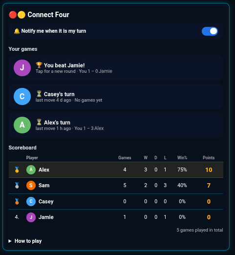
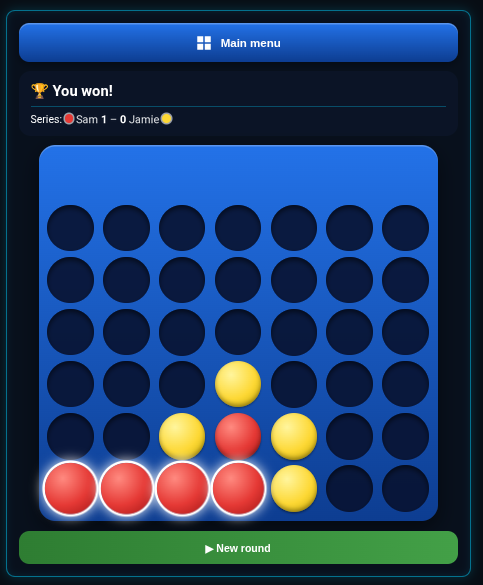

# 🔴🟡 Connect Four for Home Assistant

A family Connect Four game that runs inside Home Assistant. Everyone can play everyone at the same time
from the companion app, a wall tablet or a PC. It has a scoreboard, a running score per pair of players,
push notifications and its own sidebar entry.

<p>
  
  
</p>

## Features
- **A "Connect Four" sidebar entry** with the main menu, the boards and the scoreboard.
- **Players are picked from your Home Assistant persons**, so no YAML is needed.
- **One game per pair of players.** You can play several opponents at once, and each pair keeps its own score ("You 3 – 1 Player2").
- **Push notifications** when it is your turn ("Your turn against Player1! 🎯"). Tapping one opens the right board, and each player's phone is found automatically. Each player can turn their own notifications on or off with a switch in the main menu. They are on by default.
- **Poke** your opponent when they take their time. 30 minutes after the last move, a button next to "Player1's turn" sends them a reminder, and it can be used again every 30 minutes.
- **The last piece keeps glowing**, so you can see where your opponent played even if you open the game much later.
- **Anti-cheat:** a player who is logged in can only move in their own games, and only on their turn.
  A user that is not linked to a player can only watch, unless you add it under **Shared users** in the settings
  (for example a wall tablet), which can then play for everyone. Make sure each player's user is linked to their person
  under **Settings → People**.
- **Points:** win 3, lightning win +1 (≤ 7 own moves), draw 1, opponent resigned 3. You can change all of these.
- **Optional dashboard cards:** the full game, a small "your turn" card and a status card.
- English and Norwegian (Bokmål). The language follows your Home Assistant language setting.

## Installation (HACS)
1. HACS → ⋮ → **Custom repositories** → add `https://github.com/Gizmopower1/ha-connect-four` with type **Integration**.
2. Download **Connect Four** and restart Home Assistant.
3. Go to **Settings → Devices & services → Add integration → Connect Four**.
4. Tick the players, then pick the phone each player should be notified on.

You can change the players and the points later under **Configure** on the integration.
To change the sidebar name, rename the integration entry.

### Playing from your own dashboard
You can hide the sidebar entry and play from a dashboard instead, for example one in kiosk mode:
1. Put a `full` card on a dashboard view, such as `/games/connect-four`.
2. Under **Configure**, turn off **Show in the sidebar** and set **Page that notifications open** to that path.
3. Point any `summary` card to the same page with `navigation_path`.
4. Optional: set **Page the Home button opens** (for example `/lovelace/0`, or `/` for each user's default
   dashboard). The main menu then gets a button that leaves the game, since kiosk mode hides the sidebar.
   **Text on the Home button** changes its text.

Notifications then open that page with `?game=<id>`, and the `full` card opens the game. The hidden
panel stays reachable at `/connect-four`, so links in older notifications still work.

## Dashboard cards (optional)
The sidebar entry is all you need to play. The cards are extras for your own dashboards. The integration
registers the dashboard resource (`/connect_four_static/connect-four.js`) itself.

| Mode | What it shows |
|---|---|
| `full` | The whole game: main menu, boards and scoreboard. Opens the game named by `?game=` in the address |
| `summary` | A compact "🎯 Your turn against Player2" card. Tap it to open the game |
| `status` | Whose turn it is in every game, plus who is leading |

```yaml
type: custom:connect-four-card
mode: summary
```

Ready-to-use examples are in [`examples/`](examples):
- [`summary-card.yaml`](examples/summary-card.yaml) is the summary card, shown only to the players.
- [`full-card-view.yaml`](examples/full-card-view.yaml) is a dashboard view with the full game.
- [`wallpanel-status.yaml`](examples/wallpanel-status.yaml) is the status card on a
  [WallPanel](https://github.com/j-a-n/lovelace-wallpanel) screensaver. It is optional and only useful if you use WallPanel.

| Option | Default | Description |
|---|---|---|
| `mode` | `full` | `full`, `summary` or `status` |
| `title` | "Connect Four" | Custom heading |
| `navigation_path` | `/connect-four` | Where the `summary` card goes when tapped |
| `exit_path` | from **Configure** | Overrides the integration's **Page the Home button opens** for this card. `""` hides the button |
| `exit_label` | from **Configure** | Overrides the text on the Home button for this card |
| `exit_icon` | `mdi:home` | Icon on the Home button |
| `glass` | `false` | Dark see-through background for `status`, for use on top of photos (e.g. WallPanel) |

## Entities and actions
| Entity | |
|---|---|
| `sensor.connect_four` | Number of games in progress. The card reads its attributes |
| `sensor.connect_four_<person>` | Points for each player, plus wins, draws and losses |
| `switch.connect_four_push_<person>` | Turns push notifications on or off for one player |

Actions: `connect_four.start`, `connect_four.drop`, `connect_four.resign`, `connect_four.poke`, `connect_four.set_notifications`, and `connect_four.reset_scores` (admin only).

## Resetting games and points
Go to **Settings → Devices & services → Connect Four → Configure → Reset games and points**, and tick the box to confirm. This removes all games, including those in progress, and all series and points. Players and settings are kept. It cannot be undone.

## Upgrading from `fire_pa_rad`
Earlier versions of this integration were called `fire_pa_rad`. When you set up Connect Four, it picks up the
old players, phones, games and scores automatically, as long as the old integration is still set up. After that, remove the old integration and its
`custom_components/fire_pa_rad` folder. Then change `custom:fire-pa-rad-card` to `custom:connect-four-card` in your
dashboards. The old dashboard resource is removed automatically.

## License
MIT
